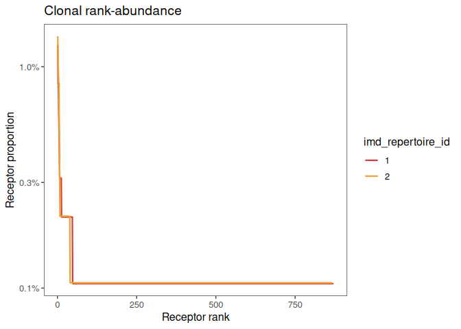
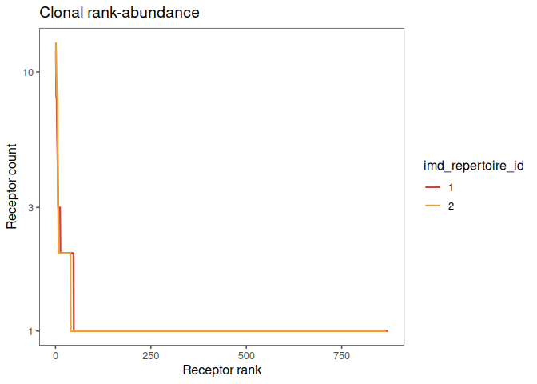
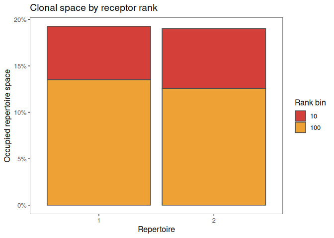
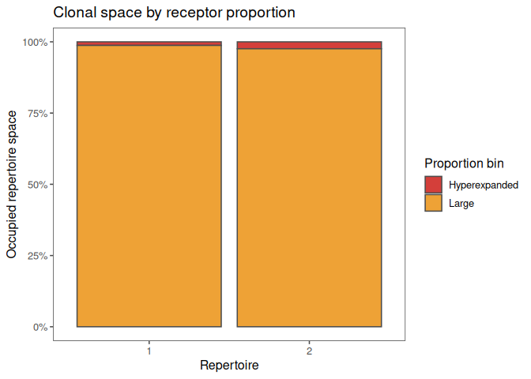

# Clonality - receptor overabundance statistics for immune repertoires

## Description

<a href="https://lifecycle.r-lib.org/articles/stages.html#experimental"></a>

A family of functions to quantify <strong>receptor
overabundance</strong> per repertoire. It helps in deciphering the
structure and partition the repertoire. Higher clonality means that one
or several receptors are over-expanded. Such effects is usually
associated with the ongoing immune system response or anomalous
behaviour, e.g., in blood cancers.

<h4>Available functions</h4>

The following methods are available.

<strong>1) Rank-abundance lines
(<code>airr_clonality_line</code>).</strong> Prepare a plot for each
repertoire. It orders receptors from most to least abundant and keeps
the top <code>limit</code> receptors. Use it to see whether a small
number of receptors dominate the repertoire: a steep line suggests
strong clonal expansion.

<strong>2) Rank-bin statistics
(<code>airr_clonality_rank</code>).</strong> Summarise how much of a
repertoire is occupied by receptors in different rank ranges. Receptors
are ordered by proportion and grouped using rank thresholds such as the
top 10, top 100, or top 1,000 receptors. Use it to compare whether
expansion is concentrated in the highest-ranked receptors across
repertoires.

<strong>3) Proportion-bin statistics
(<code>airr_clonality_prop</code>).</strong> Summarise how much of a
repertoire is occupied by receptors at different abundance levels. It
assigns each receptor to a proportion-based group, such as
<code>"Hyperexpanded"</code>, <code>"Large"</code>, or
<code>"Ultra-rare"</code>. Each bin contains receptors with the
proportion in the specified limits – just like in a histogram. Use it to
compare the balance of expanded and rare receptors across repertoires.

## Usage

<pre><code class='language-R'>airr_clonality_line(
  idata,
  limit = 1e+05,
  autojoin = getOption(IMMUNARCH_AUTOJOIN_OPTION, IMMUNARCH_AUTOJOIN_DEFAULT),
  format = c("long", "wide")
)

airr_clonality_rank(
  idata,
  bins = c(10, 30, 100, 300, 1000, 10000, 1e+05),
  autojoin = getOption(IMMUNARCH_AUTOJOIN_OPTION, IMMUNARCH_AUTOJOIN_DEFAULT),
  format = c("long", "wide")
)

airr_clonality_prop(
  idata,
  bins = c(Hyperexpanded = 0.01, Large = 0.001, Medium = 1e-04, Small = 1e-05, Rare =
    1e-06),
  autojoin = getOption(IMMUNARCH_AUTOJOIN_OPTION, IMMUNARCH_AUTOJOIN_DEFAULT),
  format = c("long", "wide")
)
</code></pre>

## Arguments

<table data-quarto-postprocess="true" role="presentation">
<tbody>
<tr>
<td
style="white-space: nowrap; font-family: monospace; vertical-align: top"><code
id="idata">idata</code></td>
<td>An immundata::ImmunData object.</td>
</tr>
<tr>
<td
style="white-space: nowrap; font-family: monospace; vertical-align: top"><code
id="limit">limit</code></td>
<td>A single whole number greater than or equal to <code>10</code>,
giving the maximum number of top receptors to keep <strong>per
repertoire</strong> (default <code>100000</code>).</td>
</tr>
<tr>
<td
style="white-space: nowrap; font-family: monospace; vertical-align: top"><code
id="autojoin">autojoin</code></td>
<td>Logical. If TRUE, join repertoire metadata by the schema repertoire
id. Change the default behaviour by calling
<code>options(immunarch.autojoin = FALSE)</code>.</td>
</tr>
<tr>
<td
style="white-space: nowrap; font-family: monospace; vertical-align: top"><code
id="format">format</code></td>
<td>String. One of <code>"long"</code> ("long" tibble with
<code>imd_repertoire_id</code>, facet columns, and <code>value</code>;
useful for visualizations) or <code>"wide"</code> (wide/unmelted table
of features, with each row corresponding to a specific repertoire / pair
of repertoires; useful for Machine Learning).</td>
</tr>
<tr>
<td
style="white-space: nowrap; font-family: monospace; vertical-align: top"><code
id="bins">bins</code></td>
<td>A named numeric vector of thresholds (e.g.,
<code>c(Hyperexpanded = 1e-2, Large = 1e-3, ...)</code>). Names become
bin labels and must be non-empty. Internally sorted in descending order
for assignment. Result rows follow the supplied bin order, with
<code>"Ultra-rare"</code> last.</td>
</tr>
</tbody>
</table>

## Value

<h4>1) Rank-abundance lines (<code>airr_clonality_line</code>)</h4>

A tibble with columns:

<ul>
<li> <code>imd_repertoire_id</code> - repertoire identifier

</li>
<li> <code>index</code> - rank within repertoire (1 = most abundant)

</li>
<li> <code>imd_count</code> - receptor count used for ranking

</li>
<li> <code>imd_proportion</code> - receptor proportion within the repertoire

</li>
<li> plus any repertoire metadata columns carried from <code>idata\$repertoires</code>

</li></ul>
<h4>2) Rank-bin statistics (<code>airr_clonality_rank</code>)</h4>

A tibble with

<ul>
<li> <code>repertoire_id</code>

</li>
<li> <code>clonal_rank_bin</code> - the rank threshold (e.g., <code>10</code>, <code>100</code>, ...)

</li>
<li> <code>occupied_prop</code> - sum of <code>proportion</code> within the bin

</li>
<li> plus repertoire metadata columns from <code>idata\$repertoires</code>

</li></ul>
<h4>3) Proportion-bin statistics (<code>airr_clonality_prop</code>)</h4>

A tibble with

<ul>
<li> <code>repertoire_id</code>

</li>
<li> <code>clonal_prop_bin</code> - factor-like label from <code>names(bins)</code> or <code>"Ultra-rare"</code>

</li>
<li> <code>occupied_prop</code> - sum of <code>proportion</code> within the bin

</li>
<li> plus repertoire metadata columns from <code>idata\$repertoires</code>

</li></ul>

## Visualisation

All three <code style="white-space: pre;">airr_clonality\_\*()</code>
results can be passed directly to <code>vis()</code>. With
<code>autojoin = TRUE</code> (the default), repertoire metadata is
included in the result and can be selected by the plotting arguments.

<h4>1) Rank-abundance lines (<code>airr_clonality_line</code>)</h4>

<code>vis()</code> plots receptor rank (<code>index</code>) against
<code>imd_proportion</code> on a logarithmic y-axis by default. The line
plot accepts:

<ul>
<li> <code>yval</code> selects either <code>"imd_proportion"</code> (the depth-normalised default) or
<code>"imd_count"</code> (raw observed counts).

</li>
<li> <code>color</code> colours the lines by a repertoire or metadata column. Lines remain
grouped by repertoire when a metadata column is selected.

</li>
<li> <code>log = FALSE</code> switches to a linear y-axis.

</li>
<li> <code>facet</code> splits the plot by one column, or creates a facet grid when given
two columns; <code>dir = "h"</code> or <code>dir = "v"</code> controls the wrapping direction.

</li>
<li> <code>title</code> replaces the default plot title.

</li></ul>
<h4>2) Rank-bin statistics (<code>airr_clonality_rank</code>)</h4>

<code>vis()</code> produces a stacked column plot of
<code>occupied_prop</code> per repertoire, filled by
<code>clonal_rank_bin</code>. Receptors beyond the largest requested
rank have a missing bin and are not drawn, so the total bar height shows
the repertoire space occupied by the displayed ranks.

<h4>3) Proportion-bin statistics (<code>airr_clonality_prop</code>)</h4>

<code>vis()</code> produces a stacked column plot of
<code>occupied_prop</code> per repertoire, filled by
<code>clonal_prop_bin</code>. The <code>"Ultra-rare"</code> bin is
included, so each complete repertoire normally sums to 100%.

Both stacked plots accept <code>xval</code>, <code>yval</code>, and
<code>fill</code> to remap columns, plus <code>facet</code>,
<code>dir</code>, and <code>title</code> for layout and labeling.

## See Also

<ul>
<li> Per-repertoire summaries: annotate_clonality

</li>
<li> Data container: immundata::ImmunData

</li></ul>

## Examples

``` r
library("immunarch")

# Limit the number of threads used by the underlying DB for this example.
# Generally, you should NOT do this in your session.
db_exec("SET threads TO 1")

# Load example data.
immdata <- get_test_idata()

#
# Analyse receptor abundance by rank.
top_line <- airr_clonality_line(immdata, limit = 1000)

# Visualise the depth-normalised rank-abundance curve.
vis(top_line)
```



``` r
# Or visualise raw receptor counts.
vis(top_line, yval = "imd_count")
```



``` r
#
# Analyse the repertoire space occupied by different rank ranges.
rank_stat <- airr_clonality_rank(immdata, bins = c(10, 100))

# Visualise the rank-bin summary.
vis(rank_stat)
```



``` r
#
# Analyse the repertoire space occupied by abundance groups.
prop_stat <- airr_clonality_prop(immdata)

# Visualise the abundance-group summary.
vis(prop_stat)
```


