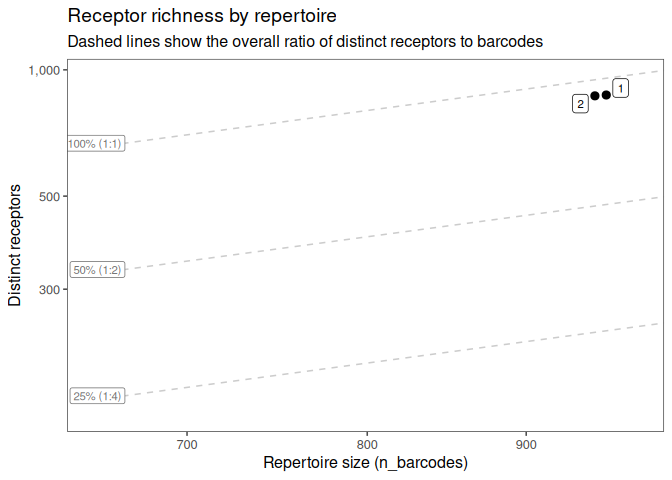
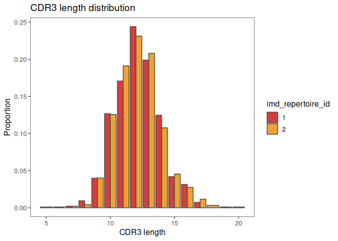
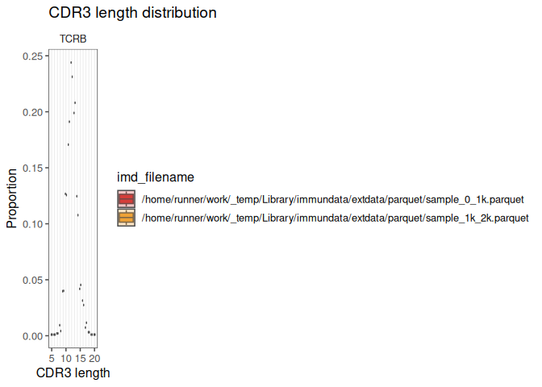
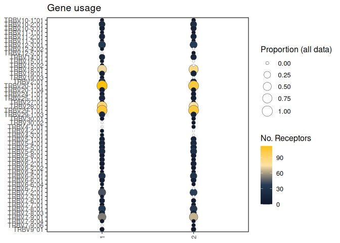
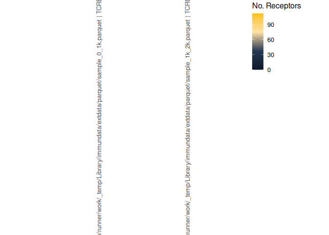

# Descriptive immune repertoire statistics

## Description

<a href="https://lifecycle.r-lib.org/articles/stages.html#experimental"></a>

A family of functions that summarise the <strong>basic structure of
immune repertoires</strong>. These summaries help you check data
quality, compare samples, and describe chain counts, sequence lengths,
and gene usage before more detailed analyses.

<h4>Available functions</h4>

The following methods are available.

<strong>1) Chain counts (<code>airr_desc_chains</code>).</strong> Count
V(D)J chains in each repertoire, optionally grouped by locus. Use this
method to check capture depth, compare library sizes, examine
TRA/TRB/IGH balance, and identify locus-specific loss or
over-representation.

<strong>2) Sequence-length distribution
(<code>airr_desc_lengths</code>).</strong> Count sequences of each
length per repertoire, optionally grouped by annotation columns. Use
this method to describe CDR3 length distributions, detect possible
library preparation bias, compare groups, and create length-based
features.

<strong>3) Gene usage (<code>airr_desc_genes</code>).</strong> Count
V(D)J gene segments per repertoire, optionally grouped by locus. The
method can count unique receptors or sum barcode/UMI counts. Use it to
compare gene usage between groups, identify unusual gene patterns, and
create repertoire-level features.

## Usage

<pre><code class='language-R'>airr_desc_chains(
  idata,
  locus_col = NA,
  autojoin = getOption(IMMUNARCH_AUTOJOIN_OPTION, IMMUNARCH_AUTOJOIN_DEFAULT),
  format = c("long", "wide")
)

airr_desc_lengths(
  idata,
  seq_col = "cdr3_aa",
  by = NA_character_,
  autojoin = getOption(IMMUNARCH_AUTOJOIN_OPTION, IMMUNARCH_AUTOJOIN_DEFAULT),
  format = c("long", "wide")
)

airr_desc_genes(
  idata,
  gene_col = "v_call",
  level = c("receptor", "barcode"),
  by = NA_character_,
  autojoin = getOption(IMMUNARCH_AUTOJOIN_OPTION, IMMUNARCH_AUTOJOIN_DEFAULT),
  format = c("long", "wide")
)
</code></pre>

## Arguments

<table data-quarto-postprocess="true" role="presentation">
<tbody>
<tr>
<td
style="white-space: nowrap; font-family: monospace; vertical-align: top"><code
id="idata">idata</code></td>
<td>An immundata::ImmunData object.</td>
</tr>
<tr>
<td
style="white-space: nowrap; font-family: monospace; vertical-align: top"><code
id="locus_col">locus_col</code></td>
<td>A single character string, <code>NA</code>, or <code>NULL</code>.
The default, <code>NA</code>, uses the canonical locus column when it is
available. Supply <code>NULL</code> to combine loci, or a column name to
group by that column.</td>
</tr>
<tr>
<td
style="white-space: nowrap; font-family: monospace; vertical-align: top"><code
id="autojoin">autojoin</code></td>
<td>Logical. If TRUE, join repertoire metadata by the schema repertoire
id. Change the default behaviour by calling
<code>options(immunarch.autojoin = FALSE)</code>.</td>
</tr>
<tr>
<td
style="white-space: nowrap; font-family: monospace; vertical-align: top"><code
id="format">format</code></td>
<td>String. One of <code>"long"</code> ("long" tibble with
<code>imd_repertoire_id</code>, facet columns, and <code>value</code>;
useful for visualizations) or <code>"wide"</code> (wide/unmelted table
of features, with each row corresponding to a specific repertoire / pair
of repertoires; useful for Machine Learning).</td>
</tr>
<tr>
<td
style="white-space: nowrap; font-family: monospace; vertical-align: top"><code
id="seq_col">seq_col</code></td>
<td>A single character string naming the sequence column.</td>
</tr>
<tr>
<td
style="white-space: nowrap; font-family: monospace; vertical-align: top"><code
id="by">by</code></td>
<td>A character vector, <code>NA</code>, or <code>NULL</code>. The
default <code>NA</code> automatically groups by the canonical
<code>locus</code> column when it is available. Supply <code>NULL</code>
to pool loci, or a character vector to group by and return those columns
explicitly.</td>
</tr>
<tr>
<td
style="white-space: nowrap; font-family: monospace; vertical-align: top"><code
id="gene_col">gene_col</code></td>
<td>A single character string naming a gene-segment column calls (e.g.,
<code>"v_call"</code>, <code>"d_call"</code>, <code>"j_call"</code>,
<code>"c_call"</code>). Default is <code>"v_call"</code>.</td>
</tr>
<tr>
<td
style="white-space: nowrap; font-family: monospace; vertical-align: top"><code
id="level">level</code></td>
<td>A single character string: <code>"receptor"</code> or
<code>"barcode"</code>. If <code>"receptor"</code> (default), the
function counts <strong>unique receptors</strong> (one per receptor ID)
that carry a given gene segment. If <code>"barcode"</code>, the function
<strong>sums counts</strong> (e.g., cells/UMIs) per gene segment using
the column defined by <code>immundata::imd_schema("count")</code>.</td>
</tr>
</tbody>
</table>

## Value

<h4>1) Chain counts (<code>airr_desc_chains</code>)</h4>

A tibble with columns:

<ul>
<li> <code>imd_repertoire_id</code> &ndash; internal repertoire identifier

</li>
<li> repertoire-summary columns carried from <code>idata</code>, such as <code>n_barcodes</code> and
<code>n_receptors</code>

</li>
<li> <code>locus</code> &ndash; TRA, TRB, IGH, ...; <code>NA</code> when locus grouping is disabled

</li>
<li> <code>n_chains</code> &ndash; number of chains

</li></ul>
<h4>2) Sequence-length distribution (<code>airr_desc_lengths</code>)</h4>

A tibble with columns:

<ul>
<li> <code>imd_repertoire_id</code> &ndash; internal repertoire identifier

</li>
<li> grouping columns requested through <code>by</code> (for example, <code>locus</code>)

</li>
<li> <code>seq_len</code> &ndash; lengths of sequences

</li>
<li> <code>n</code> &ndash; number of sequence rows

</li>
<li> <code>prop</code>, <code>pct</code> &ndash; proportion and percentage within each repertoire and
combination of grouping columns

</li></ul>
<h4>3) Gene usage (<code>airr_desc_genes</code>)</h4>

A tibble with columns:

<ul>
<li> <code style="white-space: pre;">&lt;gene_col&gt;</code> - the gene segment value (e.g., V gene)

</li>
<li> <code>imd_repertoire_id</code> - internal repertoire identifier

</li>
<li> grouping columns requested through <code>by</code> (for example, <code>locus</code>)

</li>
<li> <code>n</code> - the measure:


<ul>
<li> if <code>level = "receptor"</code>: number of receptors carrying the gene segment
within the grouping

</li>
<li> if <code>level = "barcode"</code>: sum of counts across receptors for the segment

</li></ul>

</li></ul>

## Visualisation

All three <code style="white-space: pre;">airr_desc\_\*()</code> results
can be passed directly to <code>vis()</code>. With <code>autojoin =
TRUE</code> (the default), repertoire summaries and user metadata are
included in the result and can be selected by the plotting arguments.

<h4>1) Chain counts (<code>airr_desc_chains</code>)</h4>

<code>vis()</code> plots one point per repertoire, with
<code>n_barcodes</code> on the x-axis and <code>n_receptors</code> on
the y-axis. Both axes use log scales. Dashed lines mark overall
receptor-to-barcode ratios of 100%, 50%, and 25%. Locus-specific rows
share the same repertoire totals, so they appear as one point. The plot
accepts:

<ul>
<li> <code>label</code> selects one or more columns for point labels; the default is
<code>imd_repertoire_id</code>.

</li>
<li> <code>colour</code> colours points by a repertoire metadata column. <code>fill</code> is accepted
as an alias for existing calls.

</li>
<li> <code>title</code> replaces the default plot title.

</li></ul>

For single-cell data, <code>n_barcodes</code> is the observed cell
count; for bulk data, it is total abundance. The ratio shows
repertoire-level richness, not how many receptors occur within each
barcode.

<h4>2) Sequence-length distribution (<code>airr_desc_lengths</code>)</h4>

<code>vis()</code> plots <code>seq_len</code> on the x-axis and
<code>prop</code> on the y-axis, filled by repertoire. Set
<code>fill</code> to a metadata or grouping column to compare groups
with box-and-violin distributions. <code>facet</code> accepts one column
for a wrapped layout or two columns for a facet grid; <code>dir =
"h"</code> or <code>dir = "v"</code> controls the wrapping direction.

<h4>3) Gene usage (<code>airr_desc_genes</code>)</h4>

<code>vis()</code> produces a dot plot with gene segments as rows,
repertoires as columns, and <code>n</code> mapped to dot size and
colour. Use <code>row</code> to select the gene column, <code>col</code>
to select repertoire or metadata columns, and <code>value</code> to
select the numeric measure. <code>size_max_mm</code> controls the
largest dot; <code>row_order</code> and <code>col_order</code> set the
display order.

## See Also

immundata::ImmunData

## Examples

``` r
library("immunarch")

# Limit the number of threads used by the underlying DB for this example.
# Generally, you should NOT do this in your session.
db_exec("SET threads TO 1")

# Load example data.
immdata <- get_test_idata()

#
# Count chains in each repertoire.
chain_stats <- airr_desc_chains(immdata)

# Repertoire size versus distinct receptor count
vis(chain_stats)
```



``` r
# Label and colour by repertoire metadata when those columns are available.
# vis(chain_stats, label = "Sample", colour = "Tissue")


#
# Calculate CDR3 length distributions.
length_stats <- airr_desc_lengths(immdata)

# Default: CDR3 length proportions by repertoire
vis(length_stats)
```



``` r
# Compare distributions between repertoires and split them by locus.
vis(length_stats, fill = "imd_filename", facet = "locus")
```



``` r
airr_desc_lengths(immdata, by = "locus")
```

    #> # A tibble: 28 × 7
    #>    imd_repertoire_id locus seq_len     n    prop    pct imd_filename            
    #>  *             <int> <chr>   <dbl> <int>   <dbl>  <dbl> <chr>                   
    #>  1                 1 TCRB        5     1 0.00105  0.105 /home/runner/work/_temp…
    #>  2                 1 TCRB        6     1 0.00105  0.105 /home/runner/work/_temp…
    #>  3                 1 TCRB        7     2 0.00209  0.209 /home/runner/work/_temp…
    #>  4                 1 TCRB        8     9 0.00942  0.942 /home/runner/work/_temp…
    #>  5                 1 TCRB        9    38 0.0398   3.98  /home/runner/work/_temp…
    #>  6                 1 TCRB       10   121 0.127   12.7   /home/runner/work/_temp…
    #>  7                 1 TCRB       11   163 0.171   17.1   /home/runner/work/_temp…
    #>  8                 1 TCRB       12   233 0.244   24.4   /home/runner/work/_temp…
    #>  9                 1 TCRB       13   190 0.199   19.9   /home/runner/work/_temp…
    #> 10                 1 TCRB       14   119 0.125   12.5   /home/runner/work/_temp…
    #> # ℹ 18 more rows

``` r
airr_desc_lengths(immdata, by = NULL)
```

    #> # A tibble: 28 × 6
    #>    imd_repertoire_id seq_len     n    prop    pct imd_filename                  
    #>  *             <int>   <dbl> <int>   <dbl>  <dbl> <chr>                         
    #>  1                 1       5     1 0.00105  0.105 /home/runner/work/_temp/Libra…
    #>  2                 1       6     1 0.00105  0.105 /home/runner/work/_temp/Libra…
    #>  3                 1       7     2 0.00209  0.209 /home/runner/work/_temp/Libra…
    #>  4                 1       8     9 0.00942  0.942 /home/runner/work/_temp/Libra…
    #>  5                 1       9    38 0.0398   3.98  /home/runner/work/_temp/Libra…
    #>  6                 1      10   121 0.127   12.7   /home/runner/work/_temp/Libra…
    #>  7                 1      11   163 0.171   17.1   /home/runner/work/_temp/Libra…
    #>  8                 1      12   233 0.244   24.4   /home/runner/work/_temp/Libra…
    #>  9                 1      13   190 0.199   19.9   /home/runner/work/_temp/Libra…
    #> 10                 1      14   119 0.125   12.5   /home/runner/work/_temp/Libra…
    #> # ℹ 18 more rows

``` r
#
# Calculate V gene usage from receptor counts.
gene_stats <- airr_desc_genes(
  immdata,
  gene_col = "v_call",
  level = "receptor"
)

# Default: genes by repertoire, with counts mapped to dot size and colour
vis(gene_stats)
```



``` r
# Compare gene usage across repertoires and loci.
vis(
  gene_stats,
  row = "v_call",
  col = c("imd_filename", "locus"),
  value = "n",
  size_max_mm = 5
)
```



``` r
# V gene usage by summed cell/UMI counts (if a count column is present)
airr_desc_genes(immdata, gene_col = "v_call", level = "barcode")
```

    #> # A tibble: 92 × 5
    #>    v_call      imd_repertoire_id locus     n imd_filename                       
    #>  * <chr>                   <int> <chr> <dbl> <chr>                              
    #>  1 TRBV20-1*01                 1 TCRB    123 /home/runner/work/_temp/Library/im…
    #>  2 TRBV29-1*01                 1 TCRB    122 /home/runner/work/_temp/Library/im…
    #>  3 TRBV28*01                   1 TCRB     97 /home/runner/work/_temp/Library/im…
    #>  4 TRBV18*01                   1 TCRB     86 /home/runner/work/_temp/Library/im…
    #>  5 TRBV7-9*01                  1 TCRB     60 /home/runner/work/_temp/Library/im…
    #>  6 TRBV7-2*01                  1 TCRB     44 /home/runner/work/_temp/Library/im…
    #>  7 TRBV7-8*01                  1 TCRB     36 /home/runner/work/_temp/Library/im…
    #>  8 TRBV12-3*01                 1 TCRB     36 /home/runner/work/_temp/Library/im…
    #>  9 TRBV10-2*01                 1 TCRB     32 /home/runner/work/_temp/Library/im…
    #> 10 TRBV6-5*01                  1 TCRB     28 /home/runner/work/_temp/Library/im…
    #> # ℹ 82 more rows

``` r
# Split by locus (TRA/TRB/... if locus column exists)
airr_desc_genes(immdata, gene_col = "v_call", level = "receptor", by = "locus")
```

    #> # A tibble: 92 × 5
    #>    v_call      imd_repertoire_id locus     n imd_filename                       
    #>  * <chr>                   <int> <chr> <int> <chr>                              
    #>  1 TRBV20-1*01                 1 TCRB    112 /home/runner/work/_temp/Library/im…
    #>  2 TRBV29-1*01                 1 TCRB    105 /home/runner/work/_temp/Library/im…
    #>  3 TRBV28*01                   1 TCRB     91 /home/runner/work/_temp/Library/im…
    #>  4 TRBV18*01                   1 TCRB     72 /home/runner/work/_temp/Library/im…
    #>  5 TRBV7-9*01                  1 TCRB     53 /home/runner/work/_temp/Library/im…
    #>  6 TRBV7-2*01                  1 TCRB     43 /home/runner/work/_temp/Library/im…
    #>  7 TRBV12-3*01                 1 TCRB     36 /home/runner/work/_temp/Library/im…
    #>  8 TRBV7-8*01                  1 TCRB     35 /home/runner/work/_temp/Library/im…
    #>  9 TRBV6-5*01                  1 TCRB     28 /home/runner/work/_temp/Library/im…
    #> 10 TRBV2*01                    1 TCRB     27 /home/runner/work/_temp/Library/im…
    #> # ℹ 82 more rows

``` r
# Pool loci explicitly
airr_desc_genes(immdata, gene_col = "v_call", by = NULL)
```

    #> # A tibble: 92 × 4
    #>    v_call      imd_repertoire_id     n imd_filename                             
    #>  * <chr>                   <int> <int> <chr>                                    
    #>  1 TRBV20-1*01                 1   112 /home/runner/work/_temp/Library/immundat…
    #>  2 TRBV29-1*01                 1   105 /home/runner/work/_temp/Library/immundat…
    #>  3 TRBV28*01                   1    91 /home/runner/work/_temp/Library/immundat…
    #>  4 TRBV18*01                   1    72 /home/runner/work/_temp/Library/immundat…
    #>  5 TRBV7-9*01                  1    53 /home/runner/work/_temp/Library/immundat…
    #>  6 TRBV7-2*01                  1    43 /home/runner/work/_temp/Library/immundat…
    #>  7 TRBV12-3*01                 1    36 /home/runner/work/_temp/Library/immundat…
    #>  8 TRBV7-8*01                  1    35 /home/runner/work/_temp/Library/immundat…
    #>  9 TRBV6-5*01                  1    28 /home/runner/work/_temp/Library/immundat…
    #> 10 TRBV2*01                    1    27 /home/runner/work/_temp/Library/immundat…
    #> # ℹ 82 more rows
