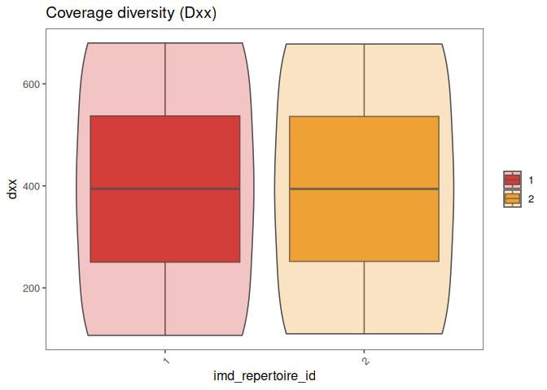
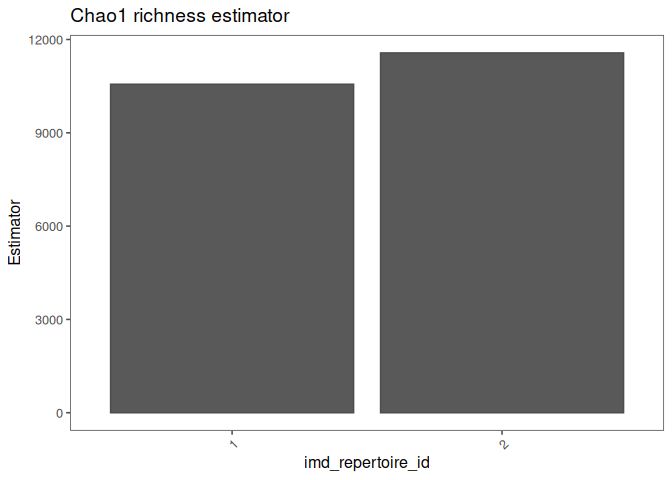
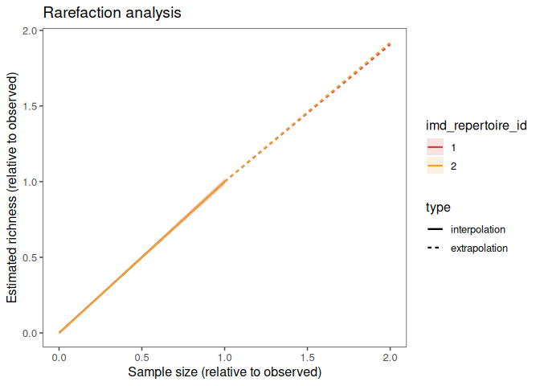
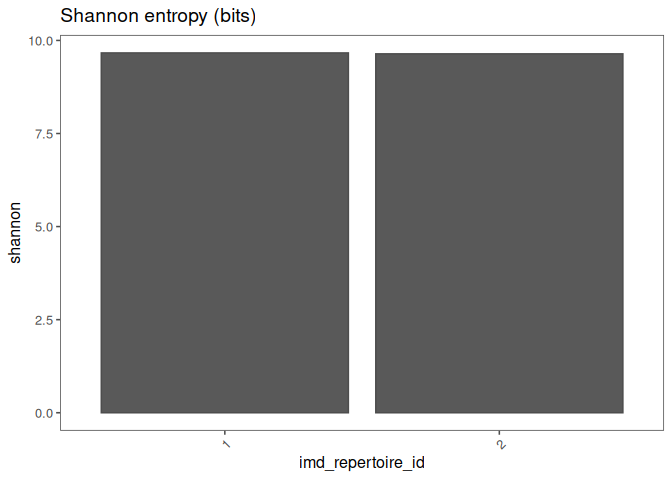
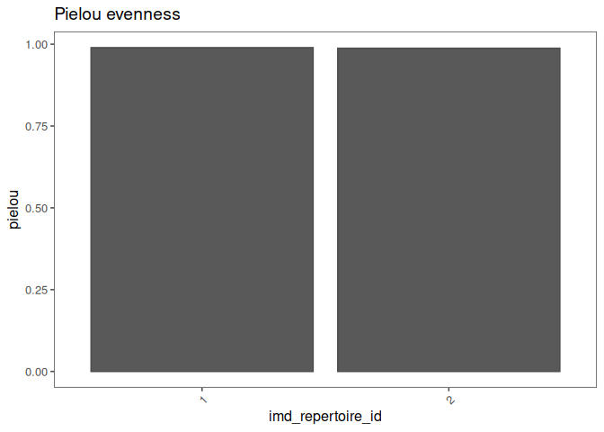
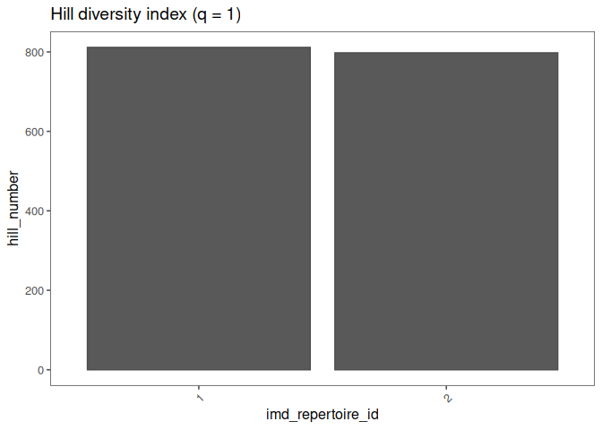

# Diversity - estimating the heterogeneity of immune repertoires

## Description

<a href="https://lifecycle.r-lib.org/articles/stages.html#experimental"></a>

A family of functions to quantify <strong>receptor diversity</strong> in
each repertoire. Diversity describes how many different receptors are
present and how evenly their abundances are distributed. These methods
help you compare repertoire structure, detect clonal expansion, and
assess sampling depth.

<h4>Available functions</h4>

The following methods are available.

<strong>1) Coverage diversity
(<code>airr_diversity_dxx</code>).</strong> Calculate the minimum number
of the most abundant receptors needed to cover
<code style="white-space: pre;">perc%</code> of a repertoire. For
example, D50 is the number of receptors that cover half of the
repertoire. Use it to identify repertoires dominated by expanded
receptors.

<strong>2) Chao1 richness (<code>airr_diversity_chao1</code>).</strong>
Estimate the total number of receptors, including receptors that may be
missing because of limited sampling. Use this non-parametric estimator
when rare receptors suggest that the observed repertoire is incomplete.

<strong>3) Rarefaction and extrapolation
(<code>airr_diversity_rarefaction</code>).</strong> Estimate how
receptor richness changes with sample size. Use interpolation to compare
repertoires at a common sampling depth and extrapolation to estimate how
many additional receptors may be found with deeper sampling.

Computation is done in RAM after one database query that fetches only
the repertoire identifier and receptor counts. Interpolation uses the
exact hypergeometric expectation for sampling without replacement.
Extrapolation uses the finite-sample Chao estimator, and confidence
bounds use bootstrap standard errors from an estimated abundance
distribution. Clonotype counts must be positive integers.

<strong>4) Shannon entropy
(<code>airr_diversity_shannon</code>).</strong> Calculate Shannon
entropy from receptor proportions in each repertoire. The value
increases when a repertoire contains more receptors or has a more even
abundance distribution. Use it as one summary that reflects both
richness and evenness.

<strong>5) Pielou evenness
(<code>airr_diversity_pielou</code>).</strong> Calculate how evenly
receptor abundance is distributed within each repertoire. The method
divides Shannon entropy by the maximum entropy for the observed
richness. Use it to compare evenness between repertoires with different
numbers of receptors.

<strong>6) Diversity index (<code>airr_diversity_index</code>).</strong>
Calculate the Hill number at <code>q = 1</code>, which is the
exponential of Shannon entropy calculated with natural logarithms. Use
it as an effective number of receptors that is easy to compare between
repertoires.

<strong>7) Hill numbers (<code>airr_diversity_hill</code>).</strong>
Calculate a diversity profile for one or more orders <code>q</code>. At
<code>q = 0</code>, the result is receptor richness; at <code>q =
1</code>, it is the exponential of Shannon entropy; higher values of
<code>q</code> give more weight to abundant receptors. Use several
orders to compare the influence of rare and abundant receptors.

## Usage

<pre><code class='language-R'>airr_diversity_dxx(
  idata,
  perc = 50,
  autojoin = getOption(IMMUNARCH_AUTOJOIN_OPTION, IMMUNARCH_AUTOJOIN_DEFAULT),
  format = c("long", "wide")
)

airr_diversity_chao1(
  idata,
  autojoin = getOption(IMMUNARCH_AUTOJOIN_OPTION, IMMUNARCH_AUTOJOIN_DEFAULT),
  format = c("long", "wide")
)

airr_diversity_rarefaction(
  idata,
  step = NA,
  quantile = c(0.025, 0.975),
  extrapolation = NA,
  nboot = 50,
  norm = TRUE,
  verbose = TRUE,
  autojoin = getOption(IMMUNARCH_AUTOJOIN_OPTION, IMMUNARCH_AUTOJOIN_DEFAULT),
  format = c("long", "wide")
)

airr_diversity_shannon(
  idata,
  autojoin = getOption(IMMUNARCH_AUTOJOIN_OPTION, IMMUNARCH_AUTOJOIN_DEFAULT),
  format = c("long", "wide")
)

airr_diversity_pielou(
  idata,
  autojoin = getOption(IMMUNARCH_AUTOJOIN_OPTION, IMMUNARCH_AUTOJOIN_DEFAULT),
  format = c("long", "wide")
)

airr_diversity_index(
  idata,
  autojoin = getOption(IMMUNARCH_AUTOJOIN_OPTION, IMMUNARCH_AUTOJOIN_DEFAULT),
  format = c("long", "wide")
)

airr_diversity_hill(
  idata,
  q = 0:5,
  autojoin = getOption(IMMUNARCH_AUTOJOIN_OPTION, IMMUNARCH_AUTOJOIN_DEFAULT),
  format = c("long", "wide")
)
</code></pre>

## Arguments

<table data-quarto-postprocess="true" role="presentation">
<tbody>
<tr>
<td
style="white-space: nowrap; font-family: monospace; vertical-align: top"><code
id="idata">idata</code></td>
<td>An immundata::ImmunData object.</td>
</tr>
<tr>
<td
style="white-space: nowrap; font-family: monospace; vertical-align: top"><code
id="perc">perc</code></td>
<td>A number or numeric vector in <code
style="white-space: pre;">(0, 100]</code> (default <code>50</code>),
e.g. <code>50</code> for D50, <code>20</code> for D20.</td>
</tr>
<tr>
<td
style="white-space: nowrap; font-family: monospace; vertical-align: top"><code
id="autojoin">autojoin</code></td>
<td>Logical. If TRUE, join repertoire metadata by the schema repertoire
id. Change the default behaviour by calling
<code>options(immunarch.autojoin = FALSE)</code>.</td>
</tr>
<tr>
<td
style="white-space: nowrap; font-family: monospace; vertical-align: top"><code
id="format">format</code></td>
<td>String. One of <code>"long"</code> ("long" tibble with
<code>imd_repertoire_id</code>, facet columns, and <code>value</code>;
useful for visualizations) or <code>"wide"</code> (wide/unmelted table
of features, with each row corresponding to a specific repertoire / pair
of repertoires; useful for Machine Learning).</td>
</tr>
<tr>
<td
style="white-space: nowrap; font-family: monospace; vertical-align: top"><code
id="step">step</code></td>
<td>A whole number greater than or equal to <code>1</code>, or
<code>NA</code>. The default, <code>NA</code>, uses up to 50 evenly
spaced points through the smallest observed depth. Each repertoire gets
up to 50 points for each remaining interpolation and extrapolation
interval.</td>
</tr>
<tr>
<td
style="white-space: nowrap; font-family: monospace; vertical-align: top"><code
id="quantile">quantile</code></td>
<td>A numeric vector of length 2 containing confidence probabilities
strictly between <code>0</code> and <code>1</code>.</td>
</tr>
<tr>
<td
style="white-space: nowrap; font-family: monospace; vertical-align: top"><code
id="extrapolation">extrapolation</code></td>
<td>A nonnegative whole number or <code>NA</code> giving the upper size
limit for extrapolation. Use <code>0</code> to disable extrapolation.
The default, <code>NA</code>, uses twice each repertoire's observed
clone count.</td>
</tr>
<tr>
<td
style="white-space: nowrap; font-family: monospace; vertical-align: top"><code
id="nboot">nboot</code></td>
<td>A nonnegative whole number that is either <code>0</code> or at least
<code>2</code>. It gives the number of bootstrap replicates used to
estimate confidence bounds. Defaults to <code>50</code>; use
<code>0</code> to return <code>NA</code> confidence bounds.</td>
</tr>
<tr>
<td
style="white-space: nowrap; font-family: monospace; vertical-align: top"><code
id="norm">norm</code></td>
<td>A single logical value; if <code>TRUE</code>, size is divided by
total repertoire size and richness estimates are divided by observed
richness.</td>
</tr>
<tr>
<td
style="white-space: nowrap; font-family: monospace; vertical-align: top"><code
id="verbose">verbose</code></td>
<td>A single logical value controlling whether a concise progress
message is shown.</td>
</tr>
<tr>
<td
style="white-space: nowrap; font-family: monospace; vertical-align: top"><code
id="q">q</code></td>
<td>A numeric scalar or vector of nonnegative orders. Defaults to
<code>0:5</code>.</td>
</tr>
</tbody>
</table>

## Value

<h4>1) Coverage diversity (<code>airr_diversity_dxx</code>)</h4>

A tibble with:

<ul>
<li> <code>imd_repertoire_id</code>

</li>
<li> <code>perc</code>

</li>
<li> <code>dxx</code> - minimal count of top receptors to reach <code style="white-space: pre;">perc%</code>

</li>
<li> plus repertoire metadata from <code>idata\$repertoires</code>

</li></ul>
<h4>2) Chao1 richness (<code>airr_diversity_chao1</code>)</h4>

A tibble with:

<ul>
<li> <code>imd_repertoire_id</code>

</li>
<li> <code>Estimator</code> - estimated receptor richness

</li>
<li> <code>SD</code> - standard deviation for the estimator value

</li>
<li> <code>Conf.95.lo</code> - CI 0.025

</li>
<li> <code>Conf.95.hi</code> - CI 0.975

</li>
<li> plus repertoire metadata from <code>idata\$repertoires</code>

</li></ul>
<h4>3) Rarefaction and extrapolation (<code>airr_diversity_rarefaction</code>)</h4>

A tibble with:

<ul>
<li> <code>imd_repertoire_id</code>

</li>
<li> <code>size</code> - sample size (absolute or normalised)

</li>
<li> <code>q_low</code> - lower confidence bound

</li>
<li> <code>mean</code> - expected richness

</li>
<li> <code>q_high</code> - upper confidence bound

</li>
<li> <code>type</code> - <code>interpolation</code> or <code>extrapolation</code>

</li>
<li> plus repertoire metadata from <code>idata\$repertoires</code>

</li></ul>
<h4>4) Shannon entropy (<code>airr_diversity_shannon</code>)</h4>

A tibble with:

<ul>
<li> <code>imd_repertoire_id</code>

</li>
<li> <code>shannon</code> - entropy in bits

</li></ul>
<h4>5) Pielou evenness (<code>airr_diversity_pielou</code>)</h4>

A tibble with:

<ul>
<li> <code>imd_repertoire_id</code>

</li>
<li> <code>shannon</code>

</li>
<li> <code>n_receptors</code>

</li>
<li> <code>pielou</code> - evenness in <code style="white-space: pre;">[0, 1]</code> (<code>NA</code> if <code>S &lt;= 1</code>)

</li></ul>
<h4>6) Diversity index (<code>airr_diversity_index</code>)</h4>

A tibble with:

<ul>
<li> <code>imd_repertoire_id</code>

</li>
<li> <code>q = 1</code>

</li>
<li> <code>hill_number</code>

</li>
<li> plus repertoire metadata from <code>idata\$repertoires</code>

</li></ul>
<h4>7) Hill numbers (<code>airr_diversity_hill</code>)</h4>

A tibble with:

<ul>
<li> <code>imd_repertoire_id</code>

</li>
<li> <code>q</code> - Hill order

</li>
<li> <code>hill_number</code> - true diversity of order <code>q</code>

</li>
<li> plus repertoire metadata from <code>idata\$repertoires</code>

</li></ul>

## Visualisation

Most <code style="white-space: pre;">airr_diversity\_\*()</code> results
can be passed directly to <code>vis()</code>. With <code>autojoin =
TRUE</code> (the default), repertoire metadata is included in the result
and can be selected by the plotting arguments.

<h4>1) Coverage diversity (<code>airr_diversity_dxx</code>)</h4>

<code>vis()</code> plots <code>dxx</code> for each repertoire. When
several <code>perc</code> values are present, use <code>fill =
"perc"</code> to show a separate column for each coverage threshold.

<h4>2) Chao1 richness (<code>airr_diversity_chao1</code>)</h4>

<code>vis()</code> produces a column plot of the estimated richness
(<code>Estimator</code>) for each repertoire.

<h4>3) Rarefaction and extrapolation (<code>airr_diversity_rarefaction</code>)</h4>

<code>vis()</code> plots estimated richness (<code>mean</code>) against
sample size (<code>size</code>). Use <code>color</code> to group curves,
<code>show_ci = FALSE</code> to hide confidence intervals, and <code>log
= TRUE</code> to use a logarithmic x-axis.

<h4>4) Shannon entropy (<code>airr_diversity_shannon</code>)</h4>

<code>vis()</code> produces a column plot of <code>shannon</code> for
each repertoire.

<h4>5) Pielou evenness (<code>airr_diversity_pielou</code>)</h4>

<code>vis()</code> produces a column plot of <code>pielou</code> for
each repertoire.

<h4>6) Diversity index (<code>airr_diversity_index</code>)</h4>

<code>vis()</code> produces a column plot of <code>hill_number</code> at
<code>q = 1</code> for each repertoire.

<h4>7) Hill numbers (<code>airr_diversity_hill</code>)</h4>

This result does not currently have a dedicated <code>vis()</code>
method. Use the returned <code>q</code> and <code>hill_number</code>
columns to create a diversity profile.

## References

Chao, A. et al. (2014). Rarefaction and extrapolation with Hill numbers:
a framework for sampling and estimation in species diversity studies.
<em>Ecological Monographs</em>, 84, 45-67.
[doi:10.1890/13-0133.1](https://doi.org/10.1890/13-0133.1)

## See Also

immundata::ImmunData

## Examples

``` r
library("immunarch")

# Limit the number of threads used by the underlying DB for this example.
# Generally, you should NOT do this in your session.
db_exec("SET threads TO 1")

# Load example data.
immdata <- get_test_idata()

#
# Calculate D50 and several coverage thresholds.
d50 <- airr_diversity_dxx(immdata, perc = 50)


d_multi <- airr_diversity_dxx(immdata, perc = c(20, 50, 80))

# Visualise the coverage diversity.
vis(d_multi)
```



``` r
#
# Estimate receptor richness.
chao <- airr_diversity_chao1(immdata)

# Visualise the richness estimates.
vis(chao)
```



``` r
#
# Calculate a rarefaction curve without extrapolation.
raref <- airr_diversity_rarefaction(immdata, step = 2000)

# Visualise the rarefaction curve.
vis(raref)
```



``` r
#
# Calculate Shannon entropy.
sh <- airr_diversity_shannon(immdata)
vis(sh)
```



``` r
#
# Calculate Pielou evenness.
pj <- airr_diversity_pielou(immdata)
vis(pj)
```



``` r
#
# Calculate the default diversity index.
idx <- airr_diversity_index(immdata)
vis(idx)
```



``` r
#
# Calculate a diversity profile for three Hill orders.
hill <- airr_diversity_hill(immdata, q = c(0, 1, 2))
```
