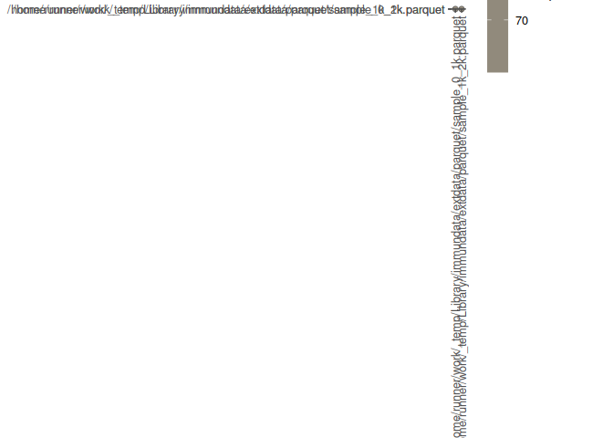
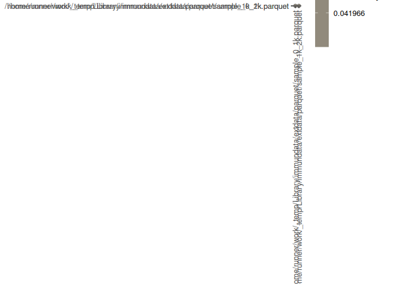
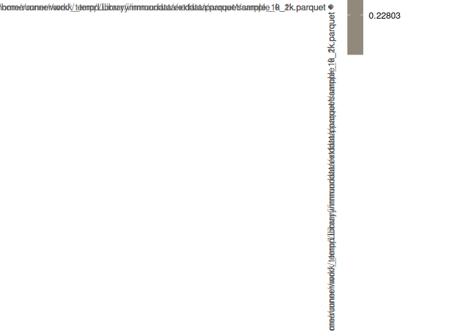
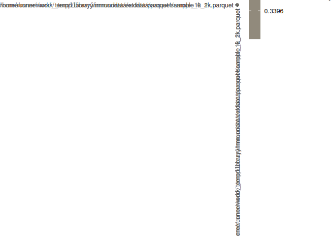
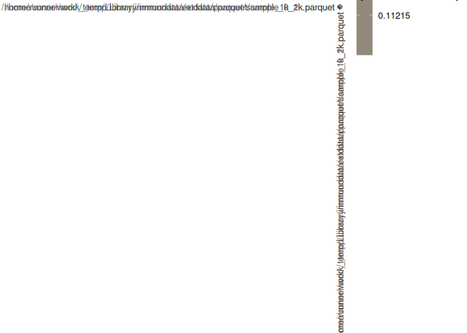
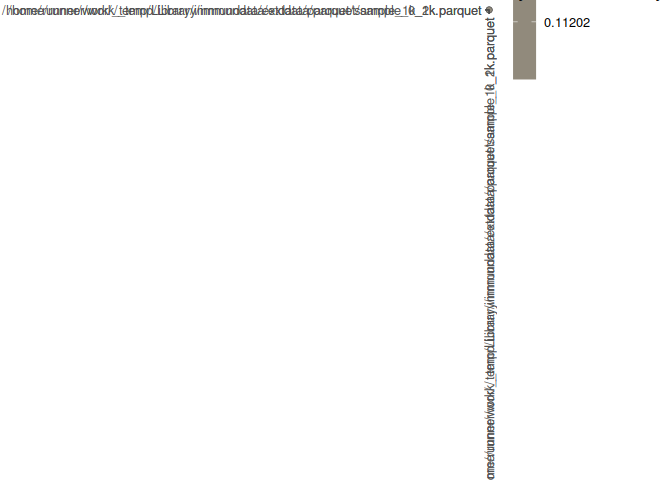

# Immune repertoire similarity

## Description

<a href="https://lifecycle.r-lib.org/articles/stages.html#experimental"></a>

A family of functions to compare <strong>shared receptors</strong>
between repertoires. These methods help you measure repertoire
similarity, identify public receptors, compare biological groups, and
check whether replicate samples have similar receptor composition.

<h4>Available functions</h4>

The following methods are available.

<strong>1) Shared-receptor counts
(<code>repsim_intersection</code>).</strong> Count the unique receptors
shared by each pair of repertoires. Use this method to find related
samples, check replicate similarity, or identify receptors shared across
many repertoires.

<strong>2) Jaccard similarity (<code>repsim_jaccard</code>).</strong>
Compare the sets of unique receptors in each pair of repertoires. The
score accounts for the total number of unique receptors in both
repertoires. Use it to compare receptor overlap when repertoire sizes
differ.

<p style="text-align: center;">

$J(A, B) = \frac{|A \cap B|}{|A \cup B|}$

<strong>3) Chao-Jaccard similarity
(<code>repsim_chao_jaccard</code>).</strong> Compare receptor overlap
using receptor counts. The method estimates similarity after allowing
for shared receptors that may be missing because one or both repertoires
were sampled at limited depth. Use it when sampling depth may affect the
observed overlap.

<strong>4) Morisita-Horn similarity
(<code>repsim_morisita_horn</code>).</strong> Compare receptor abundance
profiles. Abundant receptors have more influence on the score than rare
receptors. Use it to determine whether the same expanded receptors
dominate two repertoires. The method uses <code>imd_proportion</code> as
the abundance measure.

<p style="text-align: center;">

<code class="reqn">C\_{MH} = {(\_i + \_j) N_i N_j}</code>

<strong>5) Bray-Curtis similarity (<code>repsim_bray</code>).</strong>
Measure how similar two receptor abundance profiles are. This is one
minus Bray-Curtis dissimilarity: <code>0</code> means no overlap, and
<code>1</code> means identical abundance composition. The method uses
<code>imd_proportion</code> as the abundance measure.

Set <code>transform = "log1p"</code> to reduce the influence of the most
abundant receptors and give lower-abundance receptors more influence on
the result. This can reveal broader repertoire similarity when a few
expanded receptors would otherwise dominate the comparison. The
transformation is applied inside the database query and does not modify
<code>idata</code>.

Immune-repertoire studies commonly calculate Bray-Curtis measures from
clonotype proportions without an additional transformation. Therefore,
<code>transform = "none"</code> remains the default. The
<code>"log1p"</code> option is an exploratory sensitivity analysis based
on a common ecological pre-treatment for reducing the effect of dominant
taxa. After transformation, the values no longer sum to one, and the
result no longer has the simple interpretation of the fraction of
original repertoire abundance that overlaps.

## Usage

<pre><code class='language-R'>repsim_intersection(idata)

repsim_jaccard(idata)

repsim_chao_jaccard(idata)

repsim_morisita_horn(idata)

repsim_bray(idata, transform = c("none", "log1p"))
</code></pre>

## Arguments

<table data-quarto-postprocess="true" role="presentation">
<colgroup>
<col style="width: 50%" />
<col style="width: 50%" />
</colgroup>
<tbody>
<tr>
<td
style="white-space: nowrap; font-family: monospace; vertical-align: top"><code
id="idata">idata</code></td>
<td>An immundata::ImmunData object.</td>
</tr>
<tr>
<td
style="white-space: nowrap; font-family: monospace; vertical-align: top"><code
id="transform">transform</code></td>
<td>A single character string selecting the transformation applied to
<code>imd_proportion</code> before calculating similarity. Use
<code>"none"</code> (the default) for the original proportions or
<code>"log1p"</code> for <code>log(1 + imd_proportion)</code>.
<p><code
class="reqn">S_{BC,ij} = 1 - \frac{\sum_k |a_{ik} - a_{jk}|} {\sum_k (a_{ik} + a_{jk})} = \frac{2\sum_k \min(a_{ik}, a_{jk})}{\sum_k (a_{ik} + a_{jk})}</code>
where $a_{ik}$ is the original or transformed abundance of receptor $k$
in repertoire $i$.</p></td>
</tr>
</tbody>
</table>

## Value

<h4>1) Shared-receptor counts (<code>repsim_intersection</code>)</h4>

A <strong>symmetric numeric matrix</strong> where rows/columns are
repertoire labels derived from <code>schema_repertoire</code>. Each cell
is the count of shared unique receptors. The diagonal contains
per-repertoire richness (total unique receptors).

<h4>2) Jaccard similarity (<code>repsim_jaccard</code>)</h4>

A <strong>symmetric numeric matrix</strong> where rows/columns are
repertoire labels derived from <code>schema_repertoire</code>. Each cell
is the Jaccard similarity in <code style="white-space: pre;">\[0,
1\]</code>. The diagonal is <code>1</code>.

<h4>3) Chao-Jaccard similarity (<code>repsim_chao_jaccard</code>)</h4>

A <strong>symmetric numeric matrix</strong> where rows/columns are
repertoire labels derived from <code>schema_repertoire</code>. Each cell
is the Chao-Jaccard similarity in <code style="white-space: pre;">\[0,
1\]</code> (<code>1</code> = maximum estimated overlap, <code>0</code> =
no observed shared receptors). The diagonal is <code>1</code>.

<h4>4) Morisita-Horn similarity (<code>repsim_morisita_horn</code>)</h4>

A <strong>symmetric numeric matrix</strong> whose rows/columns are
repertoire labels derived from <code>schema_repertoire</code>, with
values in <code style="white-space: pre;">\[0, 1\]</code>
(<code>0</code> = no shared abundance, <code>1</code> = identical
abundance composition). The diagonal is <code>1</code>. Comparisons
involving an empty repertoire are <code>NA</code>.

<h4>5) Bray-Curtis similarity (<code>repsim_bray</code>)</h4>

A <strong>symmetric numeric matrix</strong> where rows/columns are
repertoire labels derived from <code>schema_repertoire</code>. Each cell
is Bray-Curtis similarity in <code style="white-space: pre;">\[0,
1\]</code> (<code>0</code> = no overlap, <code>1</code> = identical).
The diagonal is <code>1</code>.

## Visualisation

All five <code style="white-space: pre;">repsim\_\*()</code> results can
be passed directly to <code>vis()</code>. <code>vis()</code> displays
the result as a dot plot, with repertoire labels on both axes. Each dot
represents one pair of repertoires; its size and fill show the value for
that pair.

<h4>1) Shared-receptor counts (<code>repsim_intersection</code>)</h4>

Larger and brighter dots mean that the repertoires share more unique
receptors. The matrix diagonal contains repertoire richness; the plot
omits self-comparisons.

<h4>2) Jaccard similarity (<code>repsim_jaccard</code>)</h4>

Larger and brighter dots mean greater similarity between the sets of
unique receptors. Values range from <code>0</code> (no shared receptors)
to <code>1</code> (identical receptor sets).

<h4>3) Chao-Jaccard similarity (<code>repsim_chao_jaccard</code>)</h4>

Larger and brighter dots mean greater estimated similarity after
correction for receptors that may be missing because of limited
sampling. Values range from <code>0</code> (no observed shared
receptors) to <code>1</code> (maximum estimated similarity).

<h4>4) Morisita-Horn similarity (<code>repsim_morisita_horn</code>)</h4>

Larger and brighter dots mean greater similarity between receptor
abundance profiles. Values range from <code>0</code> (no overlap) to
<code>1</code> (identical abundance composition).

<h4>5) Bray-Curtis similarity (<code>repsim_bray</code>)</h4>

Larger and brighter dots mean greater similarity between receptor
abundance profiles. Values range from <code>0</code> (no overlap) to
<code>1</code> (identical abundance composition).

All plots omit self-comparisons. Their color legends mark the smallest,
midpoint, and largest plotted pairwise values.

All repertoire-similarity plots accept:

<ul>
<li> <code>size_max_mm</code> to set the maximum dot diameter.

</li>
<li> <code>row_order</code> and <code>col_order</code> to set the repertoire order on each axis.

</li></ul>

## References

Chao A, Chazdon RL, Colwell RK, Shen TJ (2005). A new statistical
approach for assessing similarity of species composition with incidence
and abundance data. <em>Ecology Letters</em>, 8(2), 148-159.
[doi:10.1111/j.1461-0248.2004.00707.x](https://doi.org/10.1111/j.1461-0248.2004.00707.x)

Horn HS (1966). Measurement of overlap in comparative ecological
studies. <em>The American Naturalist</em>, 100(914), 419-424.
[doi:10.1086/282436](https://doi.org/10.1086/282436)

Clarke KR, Chapman MG, Somerfield PJ, Needham HR (2006).
Dispersion-based weighting of species counts in assemblage analyses.
<em>Marine Ecology Progress Series</em>, 320, 11-27.
[doi:10.3354/meps320011](https://doi.org/10.3354/meps320011)

<em>The TCR assigns naive T cells to a preferred lymph node</em> (2024).
<em>Science Advances</em>.
[doi:10.1126/sciadv.adl0796](https://doi.org/10.1126/sciadv.adl0796)

\*On the feasibility of using TCR sequencing to follow a vaccination
response

<ul>
<li> lessons learned* (2023). <em>Frontiers in Immunology</em>.
[doi:10.3389/fimmu.2023.1210168](https://doi.org/10.3389/fimmu.2023.1210168)

</li></ul>

## See Also

immundata::ImmunData

## Examples

``` r
library("immunarch")

# Limit the number of threads used by the underlying DB for this example.
# Generally, you should NOT do this in your session.
db_exec("SET threads TO 1")

# Load example data.
immdata <- get_test_idata()

#
# Count receptors shared by each pair of repertoires.
m_pub <- repsim_intersection(immdata)

# Visualise the shared-receptor counts.
vis(m_pub)
```



``` r
#
# Calculate Jaccard similarity.
m_jac <- repsim_jaccard(immdata)
vis(m_jac)
```



``` r
#
# Calculate sampling-corrected Jaccard similarity.
m_chao_jac <- repsim_chao_jaccard(immdata)
vis(m_chao_jac)
```



``` r
#
# Calculate Morisita-Horn similarity.
m_mh <- repsim_morisita_horn(immdata)
vis(m_mh)
```



``` r
#
# Calculate Bray-Curtis similarity.
m_bray <- repsim_bray(immdata)
vis(m_bray)
```



``` r
# Reduce the influence of highly expanded receptors.
m_bray_log <- repsim_bray(
  immdata,
  transform = "log1p"
)
vis(m_bray_log)
```


