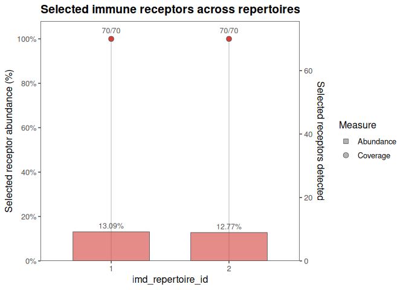
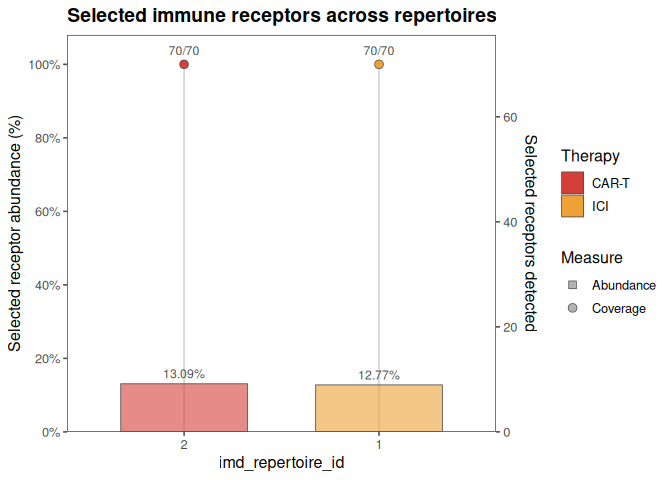

# Select receptors by their incidence across repertoires or strata

[**Source code**](https://github.com/immunomind/immunarch/tree/dev/R/#L)

## Description

Select shared receptors, receptors private to a strata, or receptors
absent above an abundance threshold. Define one or more rules to select
receptors by their sharing and abundance in comparison populations using
<code>make_public_filter()</code>.

## Usage

<pre><code class='language-R'>vdj_public(idata, ..., output = c("immundata", "df"))
</code></pre>

## Arguments

<table data-quarto-postprocess="true" role="presentation">
<tbody>
<tr>
<td
style="white-space: nowrap; font-family: monospace; vertical-align: top"><code
id="idata">idata</code></td>
<td>An immundata::ImmunData object with defined repertoires.</td>
</tr>
<tr>
<td
style="white-space: nowrap; font-family: monospace; vertical-align: top"><code
id="...">...</code></td>
<td>One or more rules created by <code>make_public_filter()</code>. With
no rules, require presence in at least two input repertoires.</td>
</tr>
<tr>
<td
style="white-space: nowrap; font-family: monospace; vertical-align: top"><code
id="output">output</code></td>
<td>A character scalar: <code>"immundata"</code> returns a new
<code>ImmunData</code>, <code>"df"</code> returns a data frame
convenient to immediately pass to <code>vis()</code>.</td>
</tr>
</tbody>
</table>

## Details

Input counts and proportions are saved as <code>imd_orig_count</code>
and <code>imd_orig_proportion</code>. The input is unchanged. No
per-rule incidence columns or custom attributes are added.

## Value

A new <code>ImmunData</code> or collected observation table.

## Repeated calls

<strong>Warning:</strong> Applying <code>vdj_public()</code> to an
already filtered result overwrites <code>imd_orig_count</code> and
<code>imd_orig_proportion</code> with abundances from its immediate
input. Since proportions are recalculated after filtering, the saved
proportions no longer refer to the repertoire before the first call.
Keep the original <code>ImmunData</code> as a reference when calculating
percentages relative to the original repertoires. To apply several rules
to the same original input, pass them together in one
<code>vdj_public()</code> call.

## Visualisation

Plot the selected receptors with <code>vis(selected, plot = "public",
reference = idata)</code>, where <code>idata</code> is the original
input to <code>vdj_public()</code>. Alternatively, pipe
<code>vdj_public(idata, output = "df")</code> to <code>vis(reference =
idata)</code>; its result class selects this plot automatically. The
ordinary observation rows in the collected output are unchanged.

Bars show <strong>abundance</strong>, the sum of the selected
identities' saved original repertoire proportions, read against the left
percentage axis. Dots show <strong>coverage</strong>, the number of
selected identities detected in each repertoire, read against the right
receptor-count axis. Dot labels give the detected/selected counts; bar
labels give abundance percentages. Observed occurrences below selection
thresholds still contribute to both measures. Coverage describes the
selected set, not the fraction of all receptor identities in a
repertoire. Individual receptor trajectories can be visualised with
<code>vdj_track()</code>.

The required <code>reference</code> defines the complete input
repertoire population, retaining repertoires with no selected receptors
at zero. Use the selected result and its own original reference:
repertoire metadata is matched using the reference repertoire schema
because filtering can rebuild repertoire IDs. The reference does not
restore abundances overwritten by repeated <code>vdj_public()</code>
calls; the saved original proportions must refer to this baseline. An
empty selection cannot be plotted.

<code>xval</code> selects a repertoire ID or metadata column for the
x-axis; each value must identify one repertoire. <code>fill</code>
selects a repertoire metadata column for colour and defaults to the
defined strata when available. Repertoires are ordered by colour group
and x value; factor levels control their order. <code>title</code>
changes the title or removes it with <code>NULL</code>.

## See Also

<code>make_public_filter()</code>, <code>annotate_public()</code>

## Examples

``` r
library("immunarch")

idata <- get_test_idata() |> agg_repertoires("Therapy")

# Keep receptors shared across at least two repertoires.
shared <- vdj_public(idata)
shared$repertoires
```

    #> # A tibble: 2 × 4
    #>   imd_repertoire_id Therapy n_barcodes n_receptors
    #>               <int> <chr>        <dbl>       <int>
    #> 1                 1 CAR-T          124          70
    #> 2                 2 ICI            122          70

``` r
vis(shared, plot = "public", reference = idata)
```



``` r
# Work with repertoire and strata rules.
idata <- get_test_idata() |>
  agg_repertoires(c("Response", "Therapy")) |>
  agg_strata("Therapy")

vdj_public(idata, output = "df") |>
  vis(reference = idata, fill = "Therapy")
```



``` r
# Inspect strata and find the IDs for the two therapies.
groups <- idata$strata
groups
```

    #> # A tibble: 2 × 3
    #>   imd_strata_id strata_name Therapy
    #>           <int> <chr>       <chr>  
    #> 1             1 Strata1     CAR-T  
    #> 2             2 Strata2     ICI

``` r
ici <- groups$imd_strata_id[groups$Therapy == "ICI"]
car_t <- groups$imd_strata_id[groups$Therapy == "CAR-T"]

# The test data has one repertoire per therapy, so use incidence >= 1.
in_ici <- vdj_public(idata, make_public_filter(
  strata = ici, min_incidence = 1L
))

# Count distinct strata instead of repertoires.
across_therapies <- vdj_public(idata, make_public_filter(
  incidence_by = "strata", min_incidence = 2L
))

# Present in ICI and absent in CAR-T. Collect the retained observations.
ici_only <- vdj_public(
  idata,
  make_public_filter(strata = ici, min_incidence = 1L),
  make_public_filter(strata = car_t, max_incidence = 0L),
  output = "df"
)
ici_only |>
  dplyr::select(
    cdr3_aa, v_call, Therapy, imd_orig_count,
    imd_orig_proportion
  ) |>
  head()
```

    #> # A tibble: 6 × 5
    #>   cdr3_aa       v_call     Therapy imd_orig_count imd_orig_proportion
    #>   <chr>         <chr>      <chr>            <dbl>               <dbl>
    #> 1 ASFPVLSPYNEQF TRBV28*01  ICI                  1             0.00105
    #> 2 ASRAGAGTGELF  TRBV19*01  ICI                  1             0.00105
    #> 3 ASRWGTEAF     TRBV19*01  ICI                  1             0.00105
    #> 4 ASRLGPNNEQF   TRBV7-2*01 ICI                  1             0.00105
    #> 5 ASSYSEGVIYGYT TRBV6-5*01 ICI                  1             0.00105
    #> 6 ASSYGPQEGYT   TRBV6-5*01 ICI                  1             0.00105

``` r
# Select by repertoire IDs and require count >= 5 in an ICI repertoire.
ids <- idata$repertoires |>
  dplyr::filter(Therapy == "ICI") |>
  dplyr::pull(imd_repertoire_id)
abundant <- vdj_public(idata, make_public_filter(
  repertoires = ids, min_count = 5
))
# All observations of passing receptors are retained throughout idata.
```
