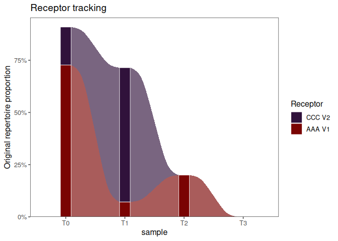
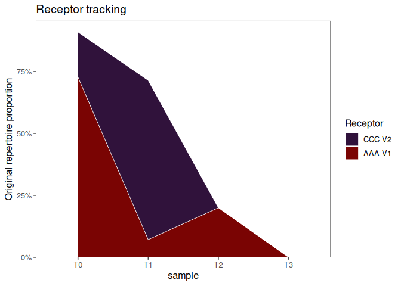
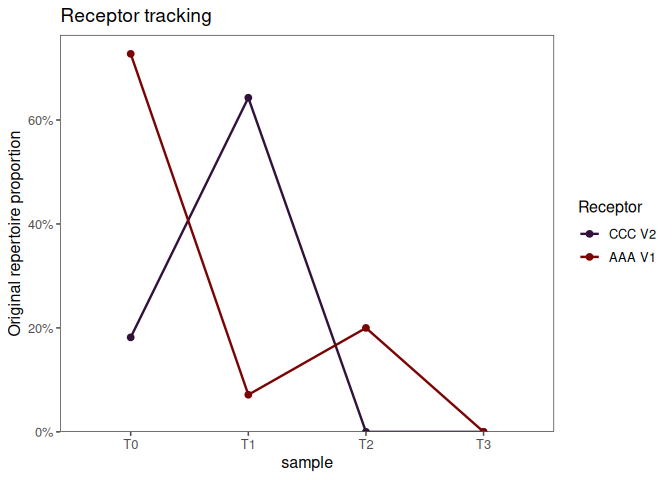
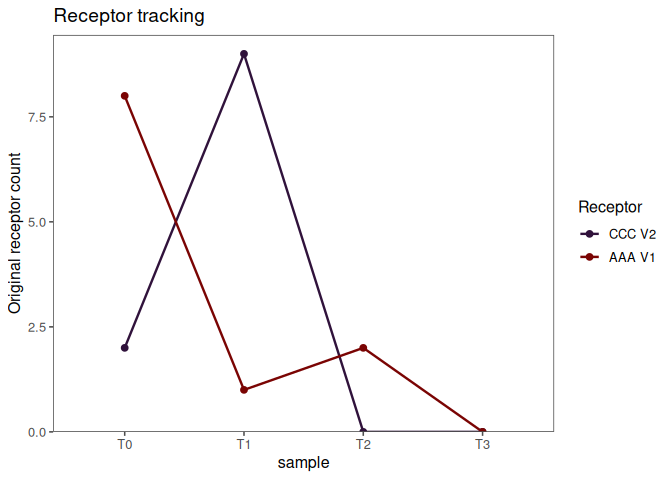

# Track selected immune receptors across time and space

[**Source code**](https://github.com/immunomind/immunarch/tree/master/R/#L)

## Description

Use <code>vdj_track()</code> to follow receptors across samples, time
points, tissues, or cell populations. For example, select abundant
receptors before treatment and find their abundances in later samples.
You can also follow a set of sequences identified in another experiment.

Select receptors with the argument <code>from</code>, or use
<code>n</code> to select the most abundant receptors in each source
repertoire. Follow them throughout the target <code>idata</code>,
including repertoires where they are rare or unobserved. The input
<code>ImmunData</code> object is not changed.

## Usage

<pre><code class='language-R'>vdj_track(idata, from = NULL, n = NULL, output = c("immundata", "df"))
</code></pre>

## Arguments

<table data-quarto-postprocess="true" role="presentation">
<tbody>
<tr>
<td
style="white-space: nowrap; font-family: monospace; vertical-align: top"><code
id="idata">idata</code></td>
<td>An immundata::ImmunData object with defined repertoires. These are
the repertoires through which receptors will be followed.</td>
</tr>
<tr>
<td
style="white-space: nowrap; font-family: monospace; vertical-align: top"><code
id="from">from</code></td>
<td><code>NULL</code>, a numeric vector of repertoire IDs, an
immundata::ImmunData object, or a data frame. <code>NULL</code>, the
default, uses every target repertoire as a source. Numeric values select
source <code>imd_repertoire_id</code> values in <code>idata</code>. An
<code>ImmunData</code> source supplies its observed receptor identities.
A data frame supplies exact column combinations to match, such as
<code>junction</code> alone or <code>junction</code> together with
<code>v_call</code>. Tibbles and duckplyr tables are also accepted.
tibble::tibble is recommended.</td>
</tr>
<tr>
<td
style="white-space: nowrap; font-family: monospace; vertical-align: top"><code
id="n">n</code></td>
<td>A non-negative whole number or <code>NULL</code>. Select up to
<code>n</code> receptors with the highest counts in each source
repertoire, then follow their combined set of identities. Equal counts
are resolved by receptor ID, as in <code>immundata::top_n()</code>.
<code>NULL</code>, the default, selects all source receptors. This
argument applies only when <code>from</code> is <code>NULL</code> or
contains repertoire IDs.</td>
</tr>
<tr>
<td
style="white-space: nowrap; font-family: monospace; vertical-align: top"><code
id="output">output</code></td>
<td>A character scalar. <code>"immundata"</code>, the default, returns a
new <code>ImmunData</code> object containing the selected receptors'
observed cells and chains. <code>"df"</code> returns an
abundance-summary tibble with one row per selected receptor and input
repertoire, including explicit zeros where unobserved. Both outputs
preserve the original target abundances. The summary retains input
receptor and repertoire IDs, receptor identity features, and repertoire
metadata as columns, and ready for plotting with
<code>vis()</code>.</td>
</tr>
</tbody>
</table>

## Details

An <code>ImmunData</code> source must use the same receptor features and
chain schema as the target. Complete feature combinations, including
both chains of a paired receptor, are matched

Column names same as in the <code>idata</code> must exist in the target
observations in the <code>from</code> argument. Matching is exact and
case-sensitive, with no sequence or gene-call normalization. Missing
query values in <code>from</code> are not allowed. Unmatched queries,
empty query tables, and <code>n = 0</code> produce an empty result.

## Value

With <code>output = "immundata"</code>, a new immundata::ImmunData
object containing the selected receptors' observed rows, with
<code>imd_orig_count</code> and <code>imd_orig_proportion</code>.

With <code>output = "df"</code>, an immunarch result tibble containing:

<ul>
<li> <code>imd_receptor_id</code> and receptor identity features from the input receptor
dictionary. Paired-chain features are shown side by side.

</li>
<li> <code>imd_receptor_label</code>, a readable label combining the receptor features.
Paired-chain labels include both loci and use <code>+</code> between chains.

</li>
<li> <code>imd_repertoire_id</code> and metadata from the input repertoire table.

</li>
<li> <code>imd_orig_count</code> and <code>imd_orig_proportion</code>, including zeros where the
receptor was unobserved. Proportions use the original repertoire totals.

</li></ul>

Each selected receptor has exactly one row in every input repertoire.
Receptor features sharing a name with repertoire metadata receive the
suffix <code style="white-space: pre;">\_receptor</code>. Barcode,
chain-observation, and other row-level fields are excluded. The tibble
is recognised by <code>vis()</code> and needs no attached repertoire
metadata. Empty selections produce a zero-row summary with the same
column structure.

## Common use cases

<ul>
<li> <strong>Follow receptors from one or several samples.</strong> Supply their repertoire
IDs through <code>from</code>. Receptors are followed in every target repertoire,
including those outside the source selection.

</li>
<li> <strong>Follow the top receptors from one sample.</strong> Supply a repertoire ID and
<code>n</code>, for example <code style="white-space: pre;">from = 5L, n = 3L</code> for the top three from repertoire ID 5.

</li>
<li> <strong>Follow the top receptors from every sample.</strong> Supply <code>n</code> and leave
<code>from = NULL</code>. A receptor selected in any source is followed everywhere,
even where it is below the top <code>n</code>. The combined set can contain more than
<code>n</code> identities.

</li>
<li> <strong>Follow an upstream selection.</strong> Pass an <code>ImmunData</code> object containing
receptors of interest, such as expanded clones or a selected cell
population. The source can also come from an independent import.

</li>
<li> <strong>Follow a sequence panel.</strong> Pass a table containing sequences and optional
gene or locus columns. All columns in a row must match the same chain;
rows are alternatives. Matching one chain keeps the complete receptor,
including its partner for paired receptors.

</li></ul>

## Original abundances

<code>imd_orig_count</code> and <code>imd_orig_proportion</code> columns
in the output store the target receptors counts and proportions before
<code>vdj_track</code> filters the data. Use these columns to compare
abundances across the original samples. The ordinary
<code>imd_count</code> and <code>imd_proportion</code> describe the
filtered object, following normal <code>immundata</code> behavior, i.e.,
normalising the proportions. Please be careful - another
<code>vdj_track</code> call replaces the original-abundance columns
<code>imd_orig_count</code> and <code>imd_orig_proportion</code>.

The <code>ImmunData</code> result contains observed chains only and
follows normal <code>immundata</code> filtering, including rebuilding
IDs for the remaining repertoires. In other words, the repertoire ID
could change after calling <code>vdj_track</code> with <code>output =
"immundata"</code>. This is temporary inconvenience, sorry for that. The
good news is that no repertoire metadata is missing so you still analyse
the data. The <code>"df"</code> summary uses the input IDs and contains
zero-count rows for unobserved combinations. These are abundance rows,
without barcode or observation-specific fields. A receptor not observed
in a sample is not necessarily biologically absent.

## Visualisation

Pass <code>vdj_track(..., output = "df")</code> directly to
<code>vis()</code>. The summary tibble carries a result class that
selects the tracking plot. The default <code>ImmunData</code> output is
intended for further analysis, so pass <code>output = "df"</code>
whenever you want to plot the results.

<code>vis()</code> draws an alluvial plot of
<code>imd_orig_proportion</code> by <code>imd_repertoire_id</code> by
default. Receptors are distinguished by colour and labelled by their
receptor features in the legend, for example
<code style="white-space: pre;">AAA V01</code>. For paired receptors,
each chain's locus and features are combined, for example
<code style="white-space: pre;">IGH AAA V01 + IGL BBB V02</code>.
Receptor IDs remain the grouping keys, so pairs sharing one chain remain
separate trajectories. The plot accepts:

<ul>
<li> <code>plot = "alluvial"</code> (the default) draws stacked bars connected by smooth
ribbons and requires the optional package <strong>ggalluvial</strong>.

</li>
<li> <code>plot = "area"</code> draws stacked areas.

</li>
<li> <code>plot = "line"</code> draws individual trajectories with
points.

</li>
<li> <code>xval</code> selects the repertoire ID or metadata column for the x-axis. The
default is to use the numeric repertoire IDs. This allows you to select
metadata columns such as &quot;Timepoint&quot;.

</li>
<li> <code>yval</code> selects <code>"imd_orig_proportion"</code> (the default) or <code>"imd_orig_count"</code>.
These preserve abundances from the original target repertoires. Proportions
are not renormalised to the selected receptors and need not sum to 100%.

</li>
<li> <code>facet</code> selects one metadata column for separate panels. Each x value
within a panel must identify exactly one repertoire. Define repertoires
upstream to pool samples; plotting does not aggregate them.

</li>
<li> <code>title</code> replaces the default title, <code>"Receptor tracking"</code>.

</li></ul>

The summary already contains zero abundances for unobserved
receptor-repertoire combinations. Every original target repertoire
remains on the plot, including samples with no tracked observations.

Repertoire metadata is returned in regular columns for every target
sample, including samples with no tracked observations. Use those
columns for <code>xval</code> and <code>facet</code>, or prepare
additional display columns in the summary.

## See Also

<ul>
<li> <code>vis()</code> for plotting the tracking abundance summary.

</li>
<li> <code>immundata::top_n()</code> for selecting abundant receptors upstream.

</li>
<li> <code>immundata::filter_immundata()</code> for filtering observations upstream.

</li></ul>

## Examples

``` r
library("immunarch")

library(immundata)

# A small bulk dataset sampled at four time points.
# At T3, only TTT is observed; neither AAA nor CCC is observed.
rows <- tibble::tibble(
  sample = c(rep(c("T0", "T1", "T2"), each = 3), "T3"),
  junction = c(
    "AAA", "CCC", "GGG", "AAA", "CCC", "TTT",
    "AAA", "GGG", "ACG", "TTT"
  ),
  v_call = c("V1", "V2", "V1", "V1", "V2", "V3", "V1", "V1", "V4", "V3"),
  abundance = c(8L, 2L, 1L, 1L, 9L, 4L, 2L, 3L, 5L, 5L)
)
input <- tempfile(fileext = ".tsv")
readr::write_tsv(rows, input)
idata <- read_repertoires(
  input,
  schema = c("junction", "v_call"), count_col = "abundance",
  repertoire_schema = "sample", output_folder = tempfile("vdj-track-"),
  preprocess = NULL, postprocess = NULL, rename_columns = NULL,
  verbose = FALSE
)
source_id <- idata$repertoires |>
  dplyr::filter(sample == "T0") |>
  dplyr::pull(imd_repertoire_id)

# Follow every receptor observed at T0, or only its two most abundant ones.
from_t0 <- vdj_track(idata, from = source_id)


top_from_t0 <- vdj_track(idata, from = source_id, n = 2L)

# Follow any receptor that is the most abundant in at least one repertoire.
top_from_each <- vdj_track(idata, n = 1L)

# An upstream selection can also supply the receptors to follow.
selected <- immundata::top_n(idata, n = 1L)
from_selected <- vdj_track(idata, from = selected)

# Match sequences alone, or exact sequence/gene combinations.
from_sequences <- vdj_track(idata, from = tibble::tibble(
  junction = c("AAA", "GGG")
))
from_panel <- vdj_track(idata, from = tibble::tibble(
  junction = c("AAA", "CCC"), v_call = c("V1", "V2")
), output = "df")

# The summary already has one row per receptor and repertoire: 2 x 4 rows.
from_panel
```

    #> # A tibble: 8 × 10
    #>   imd_receptor_id junction v_call imd_receptor_label imd_repertoire_id sample
    #> *           <int> <chr>    <chr>  <chr>                          <int> <chr> 
    #> 1               3 CCC      V2     CCC V2                             1 T0    
    #> 2               4 AAA      V1     AAA V1                             1 T0    
    #> 3               3 CCC      V2     CCC V2                             2 T1    
    #> 4               4 AAA      V1     AAA V1                             2 T1    
    #> 5               3 CCC      V2     CCC V2                             3 T2    
    #> 6               4 AAA      V1     AAA V1                             3 T2    
    #> 7               3 CCC      V2     CCC V2                             4 T3    
    #> 8               4 AAA      V1     AAA V1                             4 T3    
    #> # ℹ 4 more variables: n_barcodes <int>, n_receptors <int>,
    #> #   imd_orig_count <dbl>, imd_orig_proportion <dbl>

``` r
# Both selected receptors have explicit zero counts and proportions at T3.
from_panel |>
  dplyr::filter(sample == "T3") |>
  dplyr::select(sample, junction, imd_orig_count, imd_orig_proportion)
```

    #> # A tibble: 2 × 4
    #>   sample junction imd_orig_count imd_orig_proportion
    #>   <chr>  <chr>             <dbl>               <dbl>
    #> 1 T3     CCC                   0                   0
    #> 2 T3     AAA                   0                   0

``` r
# Select baseline receptors, then visualise their original abundances.
tracked <- vdj_track(idata, from = source_id, n = 2L, output = "df")
tracked$sample <- factor(tracked$sample, levels = c("T0", "T1", "T2", "T3"))
# T3 remains on each plot, with both receptor abundances at zero.
# Legend labels combine receptor features automatically, for example AAA V1.
vis(tracked, xval = "sample")
```



``` r
vis(tracked, xval = "sample", plot = "area")
```



``` r
vis(tracked, xval = "sample", plot = "line")
```



``` r
# Plot original counts instead of proportions.
vis(tracked, xval = "sample", plot = "line", yval = "imd_orig_count")
```


